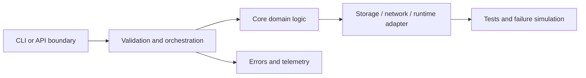

# Section 01 Capstone 2: Production Scenario

**Section:** Development Environment and Go Workflow  
**Level:** Production-shaped system

## Scenario
Become productive with the Go toolchain and understand the compile, run, test, format, and dependency workflow. Your task is to deliver a coherent system rather than a set of disconnected exercises. This capstone integrates multiple topics from the section:

- Install and inspect Go: Install a supported Go release, inspect GOROOT/GOPATH, and understand the toolchain and environment.
- Go workspace and module basics: Create modules, understand go.mod/go.sum, and work with package paths and module boundaries.
- Build, run, format and vet: Use go run, go build, go test, gofmt, go vet, and explain what each command catches.
- Editor and debugging workflow: Configure VS Code/Kiro Go support, use gopls, debugger breakpoints, and inspect runtime values.
- CLI workflow and reproducibility: Create repeatable scripts/Make targets and document commands so another engineer can reproduce a build.
- Go documentation and dependency hygiene: Navigate go doc/pkg.go.dev, choose dependencies carefully, and inspect module versions.

## Problem statement
Integrate several section topics with tests, error handling, configuration, and realistic failure modes. Create a runnable, documented implementation that solves a realistic engineering problem. Choose a scope that can be completed locally, state assumptions, and avoid adding infrastructure that is not needed to prove the learning outcomes.

## Requirements
- Define user-facing behavior, constraints, non-goals, and measurable acceptance criteria.
- Provide an architecture diagram and explain component responsibilities and data/control flow.
- Implement idiomatic Go with clear error handling and lifecycle ownership.
- Include unit tests and integration tests appropriate to the design.
- Exercise invalid inputs, dependency failures, and recovery behavior.
- Run `gofmt`, `go vet ./...`, and `go test ./...`; use race detection and benchmarks when relevant.
- Document how to build, run, test, troubleshoot, and safely clean up.
- Discuss at least two design alternatives and why the selected design fits.
- Identify one real-world use case and one situation where this design would be unnecessary or harmful.

## Suggested architecture

Adapt the diagram to the actual design. Do not force these components if the project is simpler.

## Milestones
1. Requirements and design note.
2. Thin vertical slice with a reproducible local run.
3. Core implementation and tests.
4. Failure handling and quality gates.
5. Design review, alternatives, and final demonstration.

## Acceptance criteria
- [ ] The stated user-facing requirements work.
- [ ] Design and component boundaries are explained and proportionate.
- [ ] Tests cover normal, boundary, and failure behavior.
- [ ] Build/test commands are reproducible and documented.
- [ ] No critical/high-severity issue remains.
- [ ] The learner can explain key choices and trade-offs without relying on a memorized script.

## Submission
Create your own folder under `practice/section-01/capstone-2/` containing source, tests, README, and `DESIGN.md`. This repository intentionally contains no sample implementation.

## Validation
The Validator should inspect the submitted implementation against this document, run available checks, report unrun checks honestly, and recommend a status based on evidence. Passing this capstone does not automatically pass the whole section unless all required topic criteria are also met.

## Resources
- Go documentation: https://go.dev/doc/
- Go standard library: https://pkg.go.dev/std
- Go blog: https://go.dev/blog/
