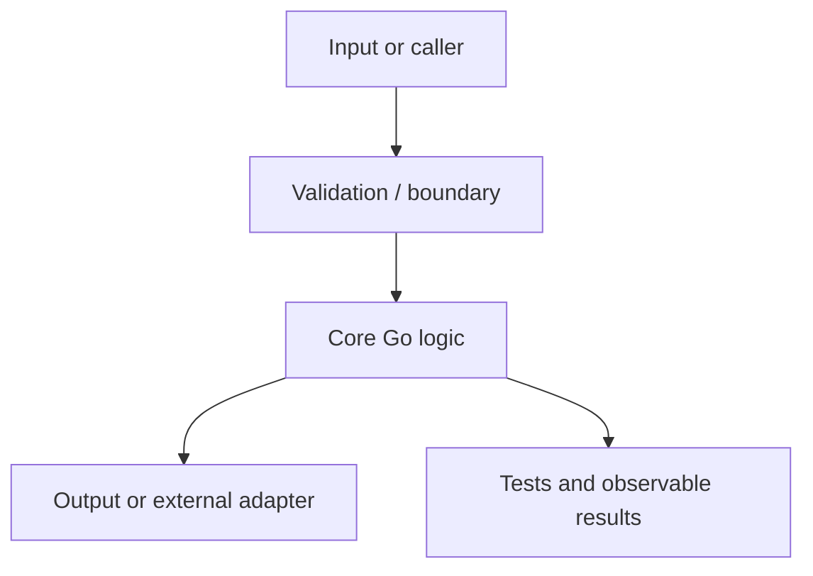

# Section 13, Topic 1: Threat modeling and secure defaults

**Section:** Security and Supply Chain Integrity

## Topic purpose
Identify assets, trust boundaries, abuse cases, and security requirements.

## Learning outcomes
By the end, you should be able to:
- Explain the mental model behind threat modeling and secure defaults.
- Implement the concept idiomatically in Go.
- Test normal, boundary, and failure behavior.
- Identify common mistakes and explain the trade-offs.
- Relate the concept to real production systems without overengineering a small exercise.

## Before starting
Read the matching section in `curriculum/section-13-security-and-supply-chain-integrity.md`. Ask the Instructor to teach the topic, check prerequisites, and assign one project at a time.

## Projects

### Project 1: Secure file/API boundary

**Level:** Focused implementation

#### Problem statement
Implement the smallest useful version that isolates the topic's main concept. Keep dependencies minimal and make the behavior easy to test. This project focuses on **threat modeling and secure defaults**: Identify assets, trust boundaries, abuse cases, and security requirements.

#### What it should do
- Deliver a runnable implementation of **Secure file/API boundary**.
- Provide an explicit contract for success, invalid input, and operational failure.
- Make important behavior observable through tests, output, logs, or metrics as appropriate.

#### Concepts practiced
- Threat modeling and secure defaults
- Error handling and explicit contracts
- Testable design and idiomatic Go
- Complexity, reliability, or operational behavior where applicable

#### Requirements and milestones
1. Write a short problem statement, assumptions, and non-goals.
2. Sketch the main components and data/control flow before coding.
3. Implement the smallest vertical slice.
4. Add tests for success, boundary conditions, and failures.
5. Run `gofmt`, `go vet ./...`, and `go test ./...`; add `go test -race ./...` when concurrency is involved.
6. Review the design, explain one alternative, and update the README with reproducible commands.

#### Suggested architecture

Treat this as a starting point, not a mandated architecture. Keep it simpler if a layered design adds no value. State where errors are handled and who owns resources/lifecycle.

#### Why this design; alternatives and trade-offs
- Keep core behavior deterministic and easy to test.
- Isolate external effects when they create meaningful failure modes.
- Compare a simple direct implementation with any proposed abstraction. Prefer the simpler option unless flexibility, testability, or separation of concerns provides a concrete benefit.
- Real-world connection: this pattern can appear in CLI tools, internal platform services, controllers, or AI platform components. Avoid introducing a service, queue, framework, or generic abstraction if the scale and requirements do not justify it.

#### Required failure exercises
- Invalid or missing input
- Empty input / boundary values
- An I/O or dependency failure where applicable
- Repeated invocation or partial completion where relevant
- For concurrent code: cancellation, boundedness, and race checks

#### Acceptance criteria
- [ ] Demonstrate the topic: threat modeling and secure defaults.
- [ ] Define clear input, output, and failure behavior.
- [ ] Include automated tests for normal behavior and at least three meaningful edge/failure cases.
- [ ] Provide reproducible build/run/test commands and a concise README for the submission.
- [ ] Explain one alternative and why it was not chosen.
- [ ] All mandatory tests pass and test output is available.
- [ ] No unexplained critical/high-severity issue remains.
- [ ] The learner can explain the implementation, one alternative, and its trade-offs.
- [ ] The reviewer can reproduce the result using the documented commands.

#### Submission
Create your own folder under `practice/`, for example `practice/section-13/topic-01-project-1/`. Include source, tests, README, and a short `DESIGN.md` for projects 2 and 3. Do not expect a starter solution to be provided.

#### Resources
- Official Go documentation: https://go.dev/doc/
- A Tour of Go: https://go.dev/tour/
- Go standard library reference: https://pkg.go.dev/std
- Go Code Review Comments: https://go.dev/wiki/CodeReviewComments

### Project 2: Authenticated multi-tenant service — applied version

**Level:** Realistic subsystem

#### Problem statement
Extend the concept into a production-like subsystem with explicit inputs/outputs, failure paths, configuration, and automated tests. This project focuses on **threat modeling and secure defaults**: Identify assets, trust boundaries, abuse cases, and security requirements.

#### What it should do
- Deliver a runnable implementation of **Authenticated multi-tenant service — applied version**.
- Provide an explicit contract for success, invalid input, and operational failure.
- Make important behavior observable through tests, output, logs, or metrics as appropriate.

#### Concepts practiced
- Threat modeling and secure defaults
- Error handling and explicit contracts
- Testable design and idiomatic Go
- Complexity, reliability, or operational behavior where applicable

#### Requirements and milestones
1. Write a short problem statement, assumptions, and non-goals.
2. Sketch the main components and data/control flow before coding.
3. Implement the smallest vertical slice.
4. Add tests for success, boundary conditions, and failures.
5. Run `gofmt`, `go vet ./...`, and `go test ./...`; add `go test -race ./...` when concurrency is involved.
6. Review the design, explain one alternative, and update the README with reproducible commands.

#### Suggested architecture

Treat this as a starting point, not a mandated architecture. Keep it simpler if a layered design adds no value. State where errors are handled and who owns resources/lifecycle.

#### Why this design; alternatives and trade-offs
- Keep core behavior deterministic and easy to test.
- Isolate external effects when they create meaningful failure modes.
- Compare a simple direct implementation with any proposed abstraction. Prefer the simpler option unless flexibility, testability, or separation of concerns provides a concrete benefit.
- Real-world connection: this pattern can appear in CLI tools, internal platform services, controllers, or AI platform components. Avoid introducing a service, queue, framework, or generic abstraction if the scale and requirements do not justify it.

#### Required failure exercises
- Invalid or missing input
- Empty input / boundary values
- An I/O or dependency failure where applicable
- Repeated invocation or partial completion where relevant
- For concurrent code: cancellation, boundedness, and race checks

#### Acceptance criteria
- [ ] Demonstrate the topic: threat modeling and secure defaults.
- [ ] Define clear input, output, and failure behavior.
- [ ] Include automated tests for normal behavior and at least three meaningful edge/failure cases.
- [ ] Provide reproducible build/run/test commands and a concise README for the submission.
- [ ] Explain one alternative and why it was not chosen.
- [ ] Separate core logic from external I/O where that improves testability.
- [ ] Add structured diagnostics or useful error context appropriate to the project.
- [ ] All mandatory tests pass and test output is available.
- [ ] No unexplained critical/high-severity issue remains.
- [ ] The learner can explain the implementation, one alternative, and its trade-offs.
- [ ] The reviewer can reproduce the result using the documented commands.

#### Submission
Create your own folder under `practice/`, for example `practice/section-13/topic-01-project-2/`. Include source, tests, README, and a short `DESIGN.md` for projects 2 and 3. Do not expect a starter solution to be provided.

#### Resources
- Official Go documentation: https://go.dev/doc/
- A Tour of Go: https://go.dev/tour/
- Go standard library reference: https://pkg.go.dev/std
- Go Code Review Comments: https://go.dev/wiki/CodeReviewComments

### Project 3: Hardened build and dependency verification pipeline — independent challenge

**Level:** Independent design challenge

#### Problem statement
Design and implement a constrained solution independently. Defend design choices, compare alternatives, test failure modes, and document operational considerations. This project focuses on **threat modeling and secure defaults**: Identify assets, trust boundaries, abuse cases, and security requirements.

#### What it should do
- Deliver a runnable implementation of **Hardened build and dependency verification pipeline — independent challenge**.
- Provide an explicit contract for success, invalid input, and operational failure.
- Make important behavior observable through tests, output, logs, or metrics as appropriate.

#### Concepts practiced
- Threat modeling and secure defaults
- Error handling and explicit contracts
- Testable design and idiomatic Go
- Complexity, reliability, or operational behavior where applicable

#### Requirements and milestones
1. Write a short problem statement, assumptions, and non-goals.
2. Sketch the main components and data/control flow before coding.
3. Implement the smallest vertical slice.
4. Add tests for success, boundary conditions, and failures.
5. Run `gofmt`, `go vet ./...`, and `go test ./...`; add `go test -race ./...` when concurrency is involved.
6. Review the design, explain one alternative, and update the README with reproducible commands.

#### Suggested architecture

Treat this as a starting point, not a mandated architecture. Keep it simpler if a layered design adds no value. State where errors are handled and who owns resources/lifecycle.

#### Why this design; alternatives and trade-offs
- Keep core behavior deterministic and easy to test.
- Isolate external effects when they create meaningful failure modes.
- Compare a simple direct implementation with any proposed abstraction. Prefer the simpler option unless flexibility, testability, or separation of concerns provides a concrete benefit.
- Real-world connection: this pattern can appear in CLI tools, internal platform services, controllers, or AI platform components. Avoid introducing a service, queue, framework, or generic abstraction if the scale and requirements do not justify it.

#### Required failure exercises
- Invalid or missing input
- Empty input / boundary values
- An I/O or dependency failure where applicable
- Repeated invocation or partial completion where relevant
- For concurrent code: cancellation, boundedness, and race checks

#### Acceptance criteria
- [ ] Demonstrate the topic: threat modeling and secure defaults.
- [ ] Define clear input, output, and failure behavior.
- [ ] Include automated tests for normal behavior and at least three meaningful edge/failure cases.
- [ ] Provide reproducible build/run/test commands and a concise README for the submission.
- [ ] Explain one alternative and why it was not chosen.
- [ ] Separate core logic from external I/O where that improves testability.
- [ ] Add structured diagnostics or useful error context appropriate to the project.
- [ ] State assumptions and non-goals.
- [ ] Discuss time/space complexity or operational cost where relevant.
- [ ] Include a short design note defending the architecture and trade-offs.
- [ ] All mandatory tests pass and test output is available.
- [ ] No unexplained critical/high-severity issue remains.
- [ ] The learner can explain the implementation, one alternative, and its trade-offs.
- [ ] The reviewer can reproduce the result using the documented commands.

#### Submission
Create your own folder under `practice/`, for example `practice/section-13/topic-01-project-3/`. Include source, tests, README, and a short `DESIGN.md` for projects 2 and 3. Do not expect a starter solution to be provided.

#### Resources
- Official Go documentation: https://go.dev/doc/
- A Tour of Go: https://go.dev/tour/
- Go standard library reference: https://pkg.go.dev/std
- Go Code Review Comments: https://go.dev/wiki/CodeReviewComments

## Topic completion
A topic is ready to be marked `Passed` only when the required project evidence specified by the learner's agreed plan has passed independent validation and the learner can explain the key concepts. Record the evidence/status in `progress.md`; do not create a separate progress file.
